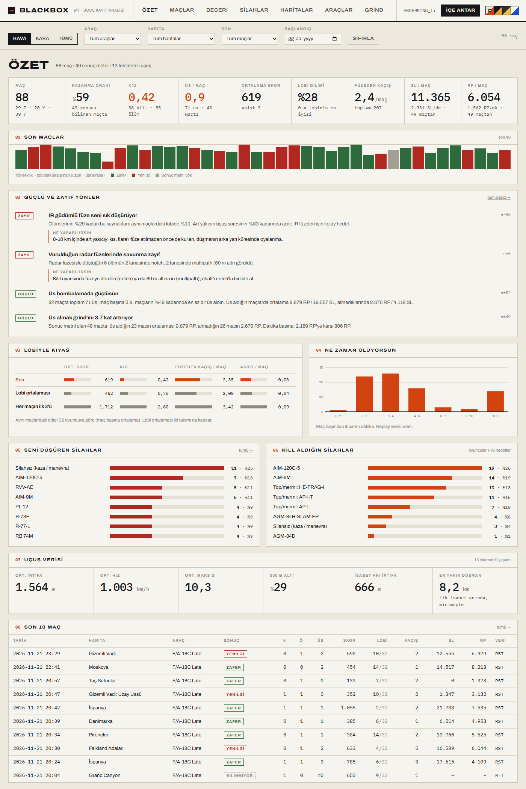
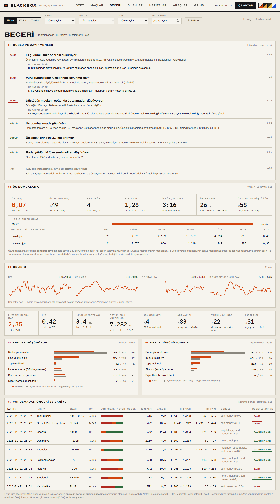
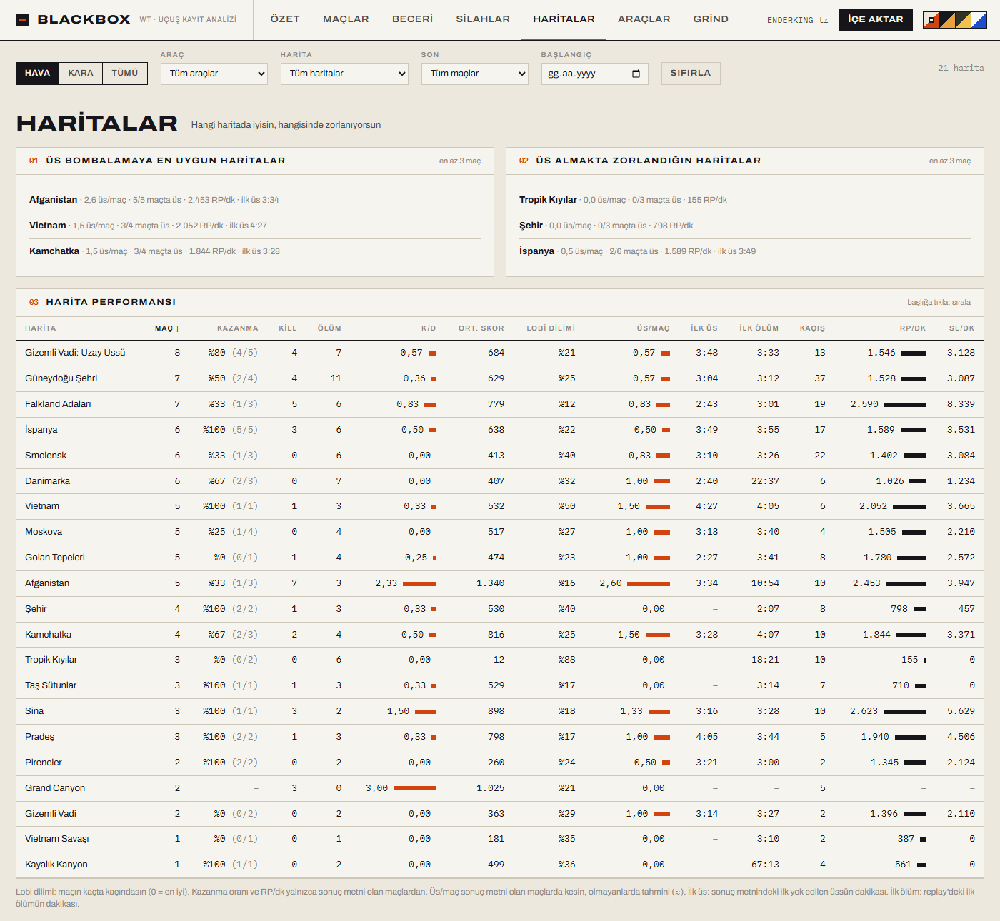
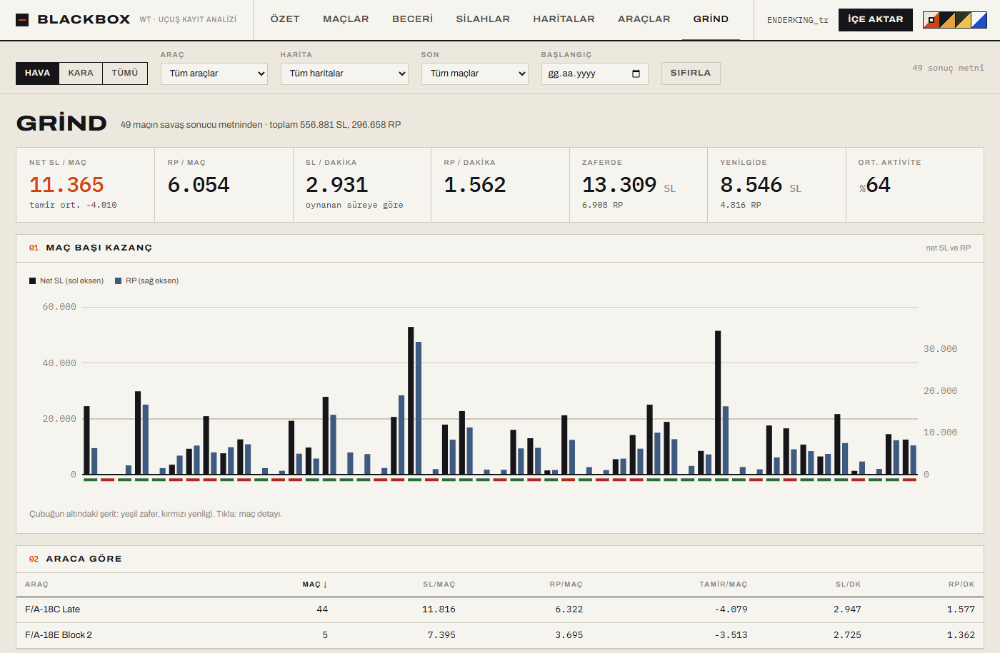
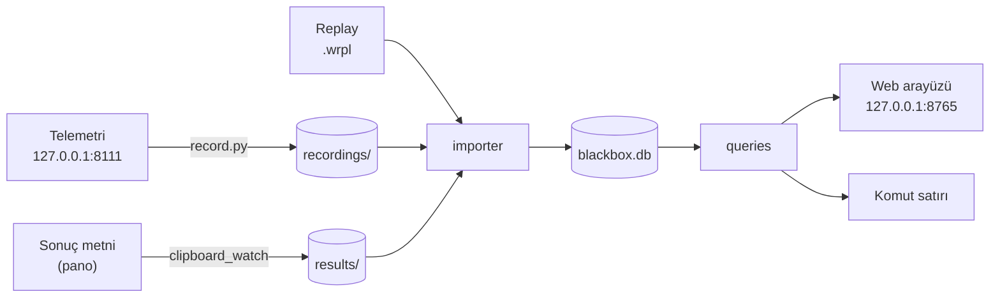

<div align="center">

# War Thunder BlackBox

**Maç sonrası uçuş kaydı ve beceri analizi.** Oyunun kendi ürettiği verilerden, hile ya da müdahale olmadan.


-2ea44f)


[Özellikler](#özellikler) · [Ekran görüntüleri](#ekran-görüntüleri) · [Kurulum](#kurulum) · [Kullanım](#kullanım) ·
[Nasıl çalışır](#nasıl-çalışır) · [Analiz yöntemleri](#analiz-yöntemleri) · [Değişiklik günlüğü](CHANGELOG.md)

</div>

---

BlackBox, War Thunder maçlarını kaydeder ve maçtan sonra sana şunları söyler: seni neyin düşürdüğü, lobiye göre
nerede güçlü ve zayıf olduğun, hangi haritada ve hangi uçakla daha verimli grind yaptığın, zaman içinde gelişip
gelişmediğin. Öncelik hava muharebeleri (Air RB); kara muharebeleri de desteklenir.

> **Güvenli tasarım.** BlackBox yalnızca oyunun herkese açık sunduğu verileri okur: yerel telemetri arayüzü
> (`127.0.0.1:8111`), diskteki replay dosyaları ve hangarda kendin kopyaladığın savaş sonucu metinleri.
> **Bellek okuma, enjeksiyon, paket dinleme, oyun dosyasına müdahale veya şifreli log çözme yoktur.**
> Maç sırasında sana hiçbir bilgi göstermez; analiz tamamen maç sonrasıdır.

## Özellikler

**Kayıt ve içe aktarma**
- Tek tıkla başlatma (`BlackBox.bat`): telemetri kaydedici, pano izleyici, web arayüzü ve otomatik içe aktarma birlikte.
- Yeni replay, telemetri kaydı ya da kopyalanan sonuç metni birkaç saniye içinde kendiliğinden içe aktarılır; açık sayfa yenilenir.
- Üç veri kaynağı oturum kimliğiyle tek bir maç görünümünde birleşir.
- Aynı bilgisayarda oynayan birden fazla oyuncu için ayrı profiller.

**Analiz**
- **Özet:** K/D, kazanma oranı, üs/maç, SL/RP (maç ve dakika başına), son 40 maçın şeridi, güçlü ve zayıf yönler, lobiyle kıyas.
- **Maç detayı:** zaman çizelgesi, uçuş profili (irtifa, hız, G), harita üzerinde rota, ödüller, iki takımın tablosu.
- **Beceri:** seni düşüren silah türleri (radar/IR füze, top, SAM, kaza) aynı maçlardaki lobiye göre; vurulmadan önceki
  15 saniyede notch, multipath, soğuk kaçış ve manevra analizi; enerji yönetimi, art yakıcı, takımın önünde uçma; somut öneriler.
- **Üs bombalama:** ton hasarı değil **alınan üs sayısı**; ilk üssün zamanı, üsler arası süre, üs almadan düşme oranı,
  üs aldığın ve almadığın maçların grind karşılaştırması.
- **Gelişim:** son 10 maçlık hareketli ortalamayla K/D, üs/maç, RP/dk, IR füzesiyle ölüm payı.
- **Haritalar ve Araçlar:** harita ve uçak bazında kazanma, K/D, üs/maç, ilk üs ve ilk ölüm dakikası, hayatta kalma, RP/SL dakika başına.
- **Grind:** maç başı SL/RP grafiği, zafer/yenilgi ayrımı, araca göre kazanç, sonuç metni eksik maçların listesi.
- **Kara muharebeleri:** kara + hava kill, seni vuran araç ve mühimmat türü, bölge ele geçirme, araçlarına göre kill/ölüm.

**Arayüz**
- Yerel web arayüzü (yalnızca bu bilgisayardan erişilir), dört renk teması, hava/kara/tümü, araç, harita ve tarih filtreleri.
- Komut satırı da aynı verilere erişir (`stats`, `battles`, `battle` ...).

## Ekran görüntüleri

<table>
<tr>
<td width="50%"><b>Özet</b><br></td>
<td width="50%"><b>Beceri</b><br></td>
</tr>
<tr>
<td><b>Haritalar</b><br></td>
<td><b>Grind</b><br></td>
</tr>
</table>

## Kurulum

1. **Python 3.14 veya üstü** kur ([python.org](https://www.python.org/downloads/)); kurulumda *Add python.exe to PATH*
   seçeneğini işaretle. 3.14 gerekir çünkü replay sıkıştırması standart kütüphanedeki `compression.zstd` ile açılır.
   Başka paket gerekmez.
2. Projeyi indir: GitHub'da **Code → Download ZIP** ya da
   ```powershell
   git clone https://github.com/EnderkingTR/War-Thunder-Black-Box.git
   ```
3. Oyun ayarlarında replay'lerin **otomatik kaydedilmesini** aç. Replay klasörün Steam varsayılanından
   (`...\steamapps\common\War Thunder\Replays`) farklıysa aşağıdaki `--replay-dir` ile belirt.
4. Proje klasöründe oyun içi adını kaydet:
   ```powershell
   python -m blackbox setup OyunIciAdin
   python -m blackbox setup OyunIciAdin --replay-dir "D:\Oyunlar\War Thunder\Replays"
   ```

## Kullanım

### Tek tıkla (önerilen)

Bir kez masaüstü kısayolunu oluştur:
```powershell
python -m blackbox shortcut
```
Masaüstündeki **BlackBox** simgesine çift tıkla: konsol penceresi açılmadan arka planda çalışır ve tarayıcıda
`http://127.0.0.1:8765` açılır. Oyna; her maçtan sonra hangardaki savaş sonucu bildiriminde **kopyala**'ya bas.
Gerisi otomatik: maç, replay ve sonuç metni birkaç saniye içinde arayüze düşer. Simgeye yeniden tıklarsan ikinci
bir kopya başlamaz, açık olan arayüz gelir. Kapatmak için arayüzde sağ üstteki **Kapat** (o an kaydedilen maç
önce kaydedilir). Arka planda çalışırken çıktılar `blackbox.log` dosyasına yazılır.

Konsol penceresini görmek istersen `BlackBox.bat`'ı kullan (ya da `python -m blackbox shortcut --console`);
orada `Ctrl+C` ile kapanır. Komutla aynısı: `python -m blackbox start`.

### Birden fazla oyuncu (aynı bilgisayar)

```powershell
python -m blackbox setup KardesinOyunAdi --add
```
Her oyuncunun ayrı veritabanı olur (`blackbox-<ad>.db`); replay'ler lobide hangi oyuncu varsa onun profiline gider.
Web arayüzünde sağ üstteki oyuncu adından profil seçilir; komut satırında `--player KardesinOyunAdi`.

### Bileşenleri ayrı ayrı çalıştırmak

```powershell
python recorder/record.py          # yalnızca telemetri kaydedici + pano izleyici
python -m blackbox import          # içe aktar
python -m blackbox web             # yalnızca web arayüzü (--port 9000, --no-browser)
```

### Komut satırı

| Komut | Ne yapar |
|---|---|
| `setup <ad> [--add] [--replay-dir]` | Oyuncu adını (veya ek profili) kaydeder |
| `start [--no-recorder] [--no-browser]` | Hepsi bir arada: kaydedici, pano, otomatik içe aktarma, arayüz |
| `shortcut [--console]` | Masaüstüne BlackBox kısayolu (varsayılan: pencere açmadan) |
| `import [--force]` | Telemetri, replay ve sonuç metinlerini işler |
| `web` | Web arayüzü |
| `stats` | Genel istatistikler, lobi kıyası, grind, silahlar |
| `battles` | Maç listesi |
| `battle <oturum\|tarih> [--lobby]` | Tek maçın detayı |
| `add-results <dosya>` | Bir dosyaya yapıştırılmış sonuç metinlerini ekler |
| `maps`, `name-map <id> <ad>` | Harita adları |
| `unknown` | Tanınmayan kill feed satırları (hata ayıklama) |

Filtreler (`stats`, `battles`): `--vehicle fa_18c_late`, `--map İspanya`, `--last 20`, `--since 2026-11-01`,
`--type air|ground|all` (varsayılan `air`). Her komutun önüne `--player <ad>` eklenebilir.

## Nasıl çalışır



| Kaynak | Ne verir | Nasıl gelir |
|---|---|---|
| Telemetri (8111) | İrtifa, hız, G, konum, minimapte görünen düşmanlar, kill feed (~10 Hz) | Kaydedici açıkken otomatik |
| Replay (`.wrpl`) | Harita, mod, kim kimi **hangi silahla** düşürdü, lobideki tüm oyuncuların skor, K/D, füzeden kaçış, bölge | Oyunun replay otomatik kaydı |
| Sonuç metni | Zafer/yenilgi, SL/RP, tamir, aktivite, **yok edilen üsler** ve zamanları | Hangarda "kopyala"; pano izleyici kaydeder |

Üç kaynak oturum kimliği (`Oturum: ...`) üzerinden aynı maça bağlanır; telemetri replay'e zaman örtüşmesiyle eşlenir.
Veritabanı türetilmiş veridir: silinse bile `import` ile yeniden oluşur.

## Analiz yöntemleri

- **Ölüm nedeni:** replay'deki kill kaydının silahı sınıflandırılır (radar/IR füze, top, SAM, kaza) ve aynı maçlardaki
  diğer oyuncuların ölümleriyle kıyaslanır.
- **Vurulmadan önceki 15 saniye:** oyun füze atışını ve RWR'ı dışarı vermediği için tehdit, minimapte görünen
  **en yakın düşman** kabul edilir. Ona göre yön: sıcak (<65°), notch (65–115°), soğuk (>115°).
  **Multipath:** radar irtifası 60 m altı. Değerlendirme füze türüne göre yapılır.
- **Enerji:** irtifa + hız²/2g; 300 m üstünde 600 km/h altında geçen süre, art yakıcı süresi, takımın önünde uçma payı.
- **Üs bombalama:** sayı sonuç metnindeki "Yok edilen üsler" satırlarından gelir. Sonuç metni olmayan maçlarda (≈)
  o uçağın üs hasarı, aynı uçağın sonuç metinli maçlarındaki üs başına hasarla sayıya çevrilir; hiç sonuç metni olmayan
  uçaklar tahmin edilmez. Diğer oyuncuların üs sayısı replay'de olmadığı için üs için lobi kıyası yapılmaz.
- **Kara:** kill = kara + hava kill. Yeniden doğan araçlar replay'de yeni kimlik aldığından ölümlerin bir kısmı araç
  türüne eşlenemeyebilir; sayfa kaçının eşlendiğini gösterir.
- Bulgular yeterli örnekle (çoğunlukla 4–8 maç/ölüm) güçlü ya da zayıf olarak işaretlenir; daha az veride "az veri" notu düşülür.

## Proje yapısı

```
BlackBox.bat, BlackBox.ico  konsollu başlatıcı ve simge
blackbox/
  __main__.py             komut satırı
  importer.py             telemetri + replay + sonuç metni -> battles
  wrpl.py                 replay okuyucu (zstd akış, kill kayıtları, sonuç BLK)
  analyze.py, skills.py   yaşamlar, savunma penceresi, enerji, sınıflandırma
  results_text.py         savaş sonucu metni ayrıştırıcı
  killfeed.py             Türkçe/İngilizce kill feed ayrıştırıcı
  queries.py, web.py      analiz sorguları, yerel HTTP sunucu ve JSON API
  static/                 arayüz (vanilla JS, SVG grafikler)
recorder/
  record.py               8111 telemetri kaydedici
  clipboard_watch.py      sonuç metni pano izleyici
dev/fake_wt_server.py     oyunsuz test için sahte 8111 sunucusu
dev/make_icon.py          simgeyi üretir
tests/                    birim testleri
```

## Bilinen sınırlamalar

- RWR, radar kilidi ve füze atışı verisi hiçbir kaynakta yok; savunma analizi bu yüzden tahminidir.
- Kazanma durumu ve kesin SL/RP yalnızca sonuç metninden gelir; kopyalanmayan maçlar gri görünür.
- Replay formatı resmi değildir; topluluk araştırmasına dayanır (WTACRP, wrpl-inspector). Bir oyun güncellemesi
  okuyucuyu bozabilir.
- "En yakın düşman" yalnızca minimapte görünen (tespit edilmiş) düşmanları kapsar.
- Arayüz ve sonuç metni ayrıştırıcı Türkçe oyun dili için yazıldı; kill feed İngilizce de tanınır.

## Geliştirme

```powershell
python -m unittest discover tests
python dev/fake_wt_server.py --port 8112
python recorder/record.py --url http://127.0.0.1:8112
```

Değişikliklerin listesi için [CHANGELOG.md](CHANGELOG.md).

## Lisans ve sorumluluk reddi

[MIT](LICENSE) lisansıyla dağıtılır.

Bu proje Gaijin Entertainment ile bağlantılı değildir ve onlar tarafından onaylanmamıştır. *War Thunder* ve ilgili
adlar Gaijin Entertainment'ın ticari markalarıdır. BlackBox yalnızca oyunun yerel telemetri arayüzünü, oyuncunun kendi
replay dosyalarını ve kopyaladığı metinleri okur; oyunun işleyişine müdahale etmez.
